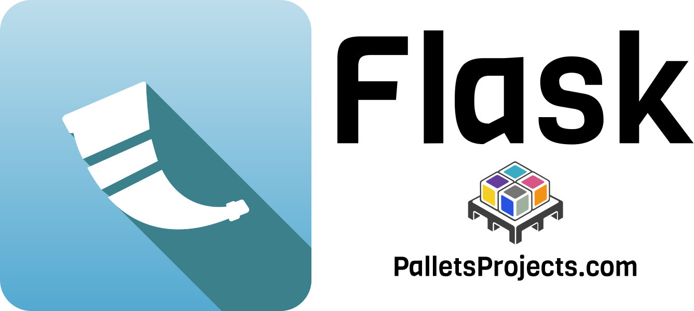
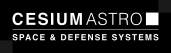
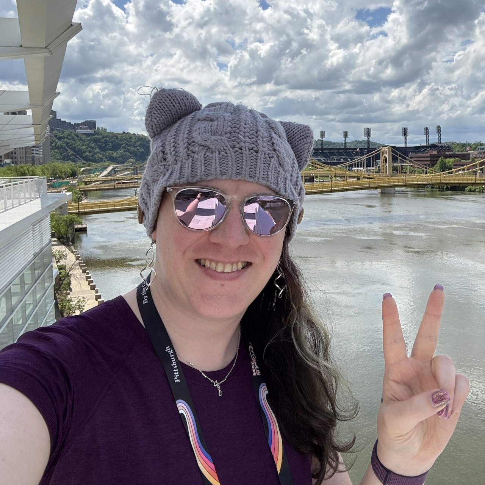

# PyBeach 2026 Sponsors and Partners

Special thanks to all of our sponsors and community partners who are helping make this event happen. If you are interested in sponsoring PyBeach, please take a look at our [sponsorship prospectus](/prospectus.html), and send us a message a [sponsors@pybeach.org](mailto:sponsors@pybeach.org).

## Platinum Sponsor: Pallets {#pallets}

    
    

      

        Pallets is the open source community organization that maintains popular Python frameworks including <a href="https://palletsprojects.com/projects/flask">Flask</a>, <a href="https://palletsprojects.com/projects/jinja">Jinja</a>, and <a href="https://palletsprojects.com/projects/click">Click</a>. The goal of Pallets is to grow the community around these projects to create a sustainable group of maintainers, contributors, and users. Check out our contributing and donation guides at <a href="https://palletsprojects.com/">PalletsProjects.com</a>.
      

    

## Gold Sponsor: Cesium Astro {#cesiumastro}

    
    

      

        A global leader in advanced connectivity solutions for space and defense, CesiumAstro delivers space systems that connect, detect, and defend across commercial, government, and national security missions. Its full-stack, multi-mission hardware and software spans satellites, high-performance communications payloads and advanced computing systems, all designed, manufactured, and tested in-house to AS9100D/ISO 9001:2015 standards.
      

      

        Software sits at the core of that work. CesiumAstro engineers write the code that steers beams, processes signals, runs ground and flight systems, and turns data into answers for customers. Recent acquisitions of Vidrovr (AI and data analysis) and 1Aardvark (mission software) expand what those teams build.
      

      

        Headquartered near Austin, Texas, CesiumAstro operates additional facilities in Colorado, California, Washington, D.C., Florida, the United Kingdom, Germany, Taiwan, Singapore, and Japan. Join the team at <a href="https://CesiumAstro.com/careers">CesiumAstro.com/careers</a>.
      

    

## Individual Sponsor: Carol Willing

    
    

      

        Website <a href="https://willingconsulting.com">https://willingconsulting.com</a>
      

    

### Individual Sponsor: Amethyst Reese {#amethyst}

    
    

      

      Website: <a href="https://amethyst.cat/">https://amethyst.cat/</a>
      

    

